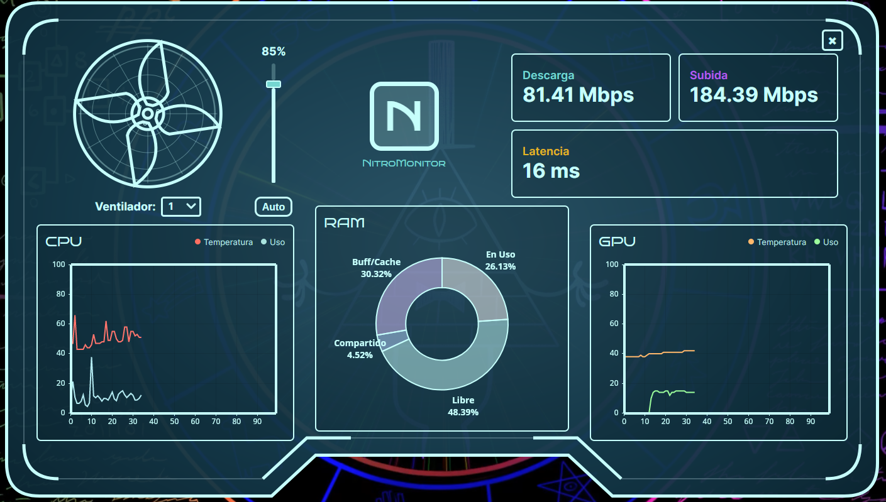

# NitroMonitor

**NitroMonitor** is a Linux desktop application designed to provide a centralized and visually appealing interface for monitoring and managing hardware resources, especially on gaming laptops.

The goal of this project is to bring Linux users an experience similar to the hardware control and monitoring software commonly available on gaming laptops running Windows, bringing all essential information and controls together in a single screen.

## Features

- **CPU Monitoring:** Real-time CPU temperature and usage monitoring.
- **GPU Monitoring:** Real-time NVIDIA GPU temperature and usage monitoring.
- **RAM Monitoring:** Displays memory statistics, including:
    - Free memory.
    - Used memory.
    - Shared memory.
    - Buff/cache.
- **Fan Control:** Manage fan speeds manually (0–100%) or switch to automatic mode.
- **Network Monitoring:** Real-time internet upload and download speeds, as well as network latency.

## Screenshots

Here is a screenshot of NitroMonitor's interface:



## Technologies

- **Framework:** Avalonia UI (.NET)
- **Programming Language:** C#
- **Design Pattern:** MVVM (Model-View-ViewModel)
- **Chart Library:** ScottPlot
- **Network Speed Testing:** NetPace.Core (Ookla Speedtest)

## Requirements

Before running NitroMonitor, make sure your system meets the following requirements.

### Hardware Requirements

- **CPU:** Intel processor with compatible temperature sensors supported by `lm-sensors`.
- **GPU:** NVIDIA graphics card supported by the proprietary NVIDIA drivers.
- **Operating System:** Linux.
- **Laptop:** A laptop supported by NBFC-Linux for fan control.

### Software Requirements

The following system utilities are required:

| Package | Purpose |
|---|---|
| `bash` | Executes system commands. |
| `procps` / `procps-ng` | Provides `top` and `free`. |
| `gawk` | Processes command output using `awk`. |
| `grep` | Filters system information. |
| `coreutils` | Provides utilities such as `tee` and `tr`. |
| `lm-sensors` | Reads CPU temperature sensors. |
| `nvidia-utils` | Provides `nvidia-smi` for GPU monitoring. |
| `sudo` | Executes privileged commands. |
| `nbfc-linux` | Controls laptop fans. |

Additional requirements:

- NVIDIA proprietary drivers must be installed and working correctly.
- The `nvidia-smi` command must be available in the system PATH.
- The Linux kernel must provide the `ec_sys` module with write support for compatible laptop fan controllers.
- An active internet connection is required for network speed testing.
- .NET runtime matching the application's target framework is required when using a framework-dependent precompiled build.

**Important:** NitroMonitor must be executed with root privileges using `sudo` for hardware monitoring and fan control functionality to work correctly.

## Preparing Your Linux System

Before installing or running NitroMonitor, install the required system dependencies.

### Ubuntu / Debian

Update your package repositories:

```bash
sudo apt update
```

Install the required packages:

```bash
sudo apt install bash procps gawk grep coreutils lm-sensors sudo
```

Install the NVIDIA proprietary drivers and their corresponding utilities.

On Ubuntu, you can check the recommended driver with:

```bash
ubuntu-drivers devices
```

Install the recommended driver:

```bash
sudo ubuntu-drivers autoinstall
```

Restart your system after installing the drivers:

```bash
sudo reboot
```

Verify that NVIDIA is working:

```bash
nvidia-smi
```

If the command displays your GPU information, the NVIDIA installation is working correctly.

### Arch Linux

Update your system:

```bash
sudo pacman -Syu
```

Install the required packages:

```bash
sudo pacman -S bash procps-ng gawk grep coreutils lm_sensors sudo nvidia-utils
```

Install the appropriate NVIDIA kernel driver for your system and kernel configuration.

For example, the standard NVIDIA kernel module package may be:

```bash
sudo pacman -S nvidia
```

The appropriate driver package depends on your kernel. Consult the official Arch Linux NVIDIA documentation if necessary.

Verify that NVIDIA is working:

```bash
nvidia-smi
```

## Configuring Hardware Monitoring

### CPU Temperature

NitroMonitor uses `lm-sensors` to read CPU temperature information.

Detect available sensors:

```bash
sudo sensors-detect
```

Follow the recommended configuration and then check the available sensors:

```bash
sensors
```

NitroMonitor currently reads the temperature using the `Package id 0` sensor, so a compatible Intel CPU and sensor configuration are required.

### NVIDIA GPU Monitoring

NitroMonitor uses `nvidia-smi` to obtain GPU temperature and utilization.

Verify GPU availability:

```bash
nvidia-smi --query-gpu=temperature.gpu,utilization.gpu --format=csv,noheader,nounits
```

If this command returns temperature and utilization values, GPU monitoring should work correctly.

### Fan Control (NBFC-Linux)

NitroMonitor uses NBFC-Linux to manage laptop fan speeds.

Install NBFC-Linux following the instructions in its official repository:

https://github.com/nbfc-linux/nbfc-linux

Make sure your laptop model is supported and properly configured.

Start the NBFC service:

```bash
sudo nbfc start
```

Check its status:

```bash
nbfc status
```

Verify that fan sensors are detected:

```bash
nbfc sensors show
```

**Important:** Fan control depends on laptop compatibility with NBFC-Linux. Not all laptop models support manual fan control.

### EC Module Configuration

NitroMonitor attempts to enable write access to the `ec_sys` kernel module using:

```bash
echo Y | sudo tee /sys/module/ec_sys/parameters/write_support
```

If the module is not loaded, you may need to load it manually:

```bash
sudo modprobe ec_sys write_support=1
```

This functionality depends on kernel support and laptop hardware compatibility. Writing directly to embedded controller registers can be risky on unsupported hardware.

## Installation

You have two options to get NitroMonitor.

### Option 1: Use a Precompiled Version

You can find a precompiled version of NitroMonitor in the `compiled/` directory of this repository.

Download or extract the appropriate build and navigate to its directory.

Run the application using:

```bash
sudo ./NitroMonitor
```

If the executable does not have execution permissions:

```bash
chmod +x NitroMonitor
```

Then run it again:

```bash
sudo ./NitroMonitor
```

If the build is framework-dependent, make sure the corresponding .NET runtime is installed.

### Option 2: Build from Source

You can compile NitroMonitor yourself using the .NET SDK.

1. Install the .NET SDK matching the project's target framework.

2. Clone the repository:

```bash
git clone https://github.com/Daniel081004/NitroMonitor
```

3. Navigate to the project directory:

```bash
cd NitroMonitor
```

4. Restore NuGet dependencies:

```bash
dotnet restore
```

5. Build the project:

```bash
dotnet build
```

6. Run the application with root privileges:

```bash
sudo dotnet run
```

Alternatively, publish the application:

```bash
dotnet publish -c Release
```

Then execute the published application using the appropriate output directory and deployment configuration.

## Troubleshooting

### NVIDIA GPU Not Detected

Check whether the NVIDIA drivers are installed:

```bash
nvidia-smi
```

If the command is not found or returns an error, verify your NVIDIA driver installation.

### CPU Temperature Not Available

Check the available sensors:

```bash
sensors
```

Make sure the `Package id 0` sensor is available. NitroMonitor currently depends on this specific sensor name.

### NBFC-Linux Not Working

Check the service status:

```bash
nbfc status
```

Verify that your laptop model is supported by NBFC-Linux and that the correct configuration is installed.

### Permission Errors

Make sure NitroMonitor is executed with root privileges:

```bash
sudo ./NitroMonitor
```

### EC Module Not Available

Check whether the module exists:

```bash
lsmod | grep ec_sys
```

If necessary, try loading it:

```bash
sudo modprobe ec_sys write_support=1
```

## Architecture

NitroMonitor uses the **MVVM (Model-View-ViewModel)** design pattern with Avalonia UI.

Currently, the application interface is centralized in `MainWindow`, rather than being separated into multiple View components.

## License

NitroMonitor is intended to be free to use, modify, and distribute.

If you create your own version or derivative project based on NitroMonitor, giving credit to the original project is greatly appreciated, although it is not mandatory.

**License note:** To make these permissions legally clear, consider publishing the project under the MIT License. It allows commercial and non-commercial use, modification, and redistribution, without requiring attribution to the original author. Attribution can instead be requested as a courtesy.

If you find NitroMonitor useful, consider giving the repository a star on GitHub!